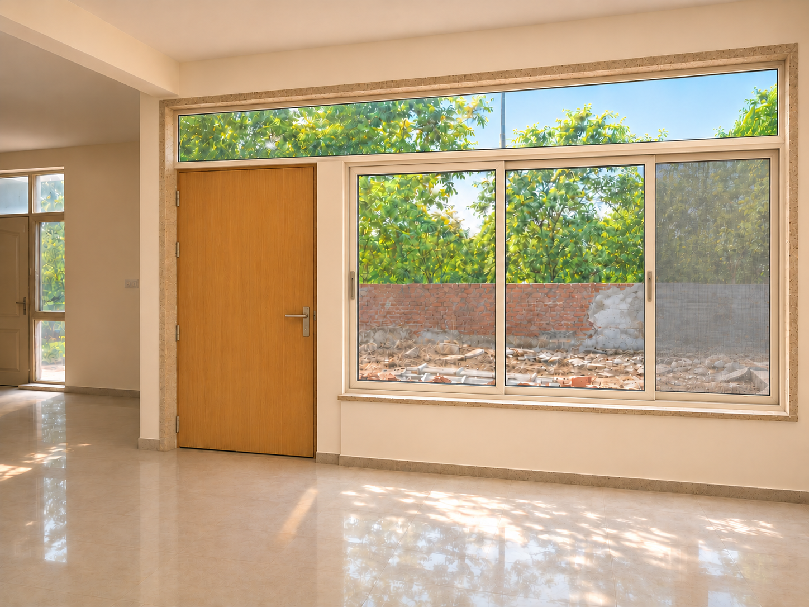
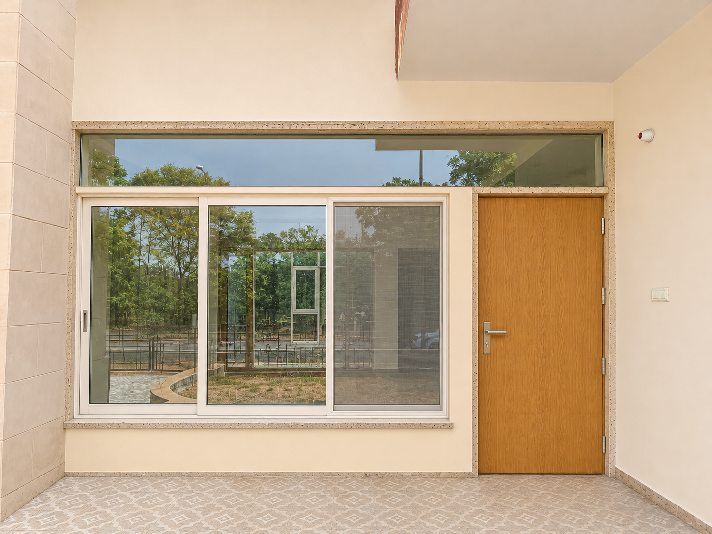
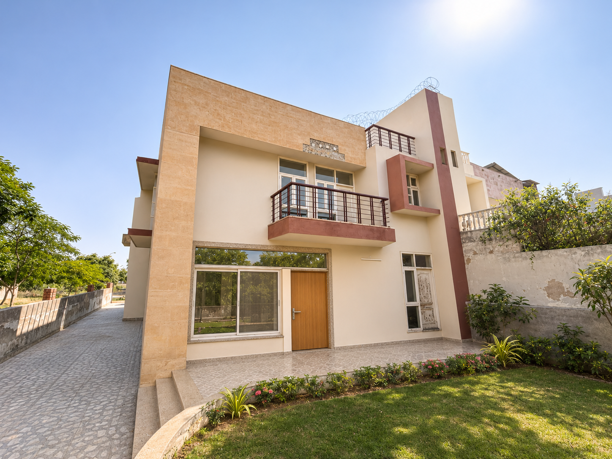
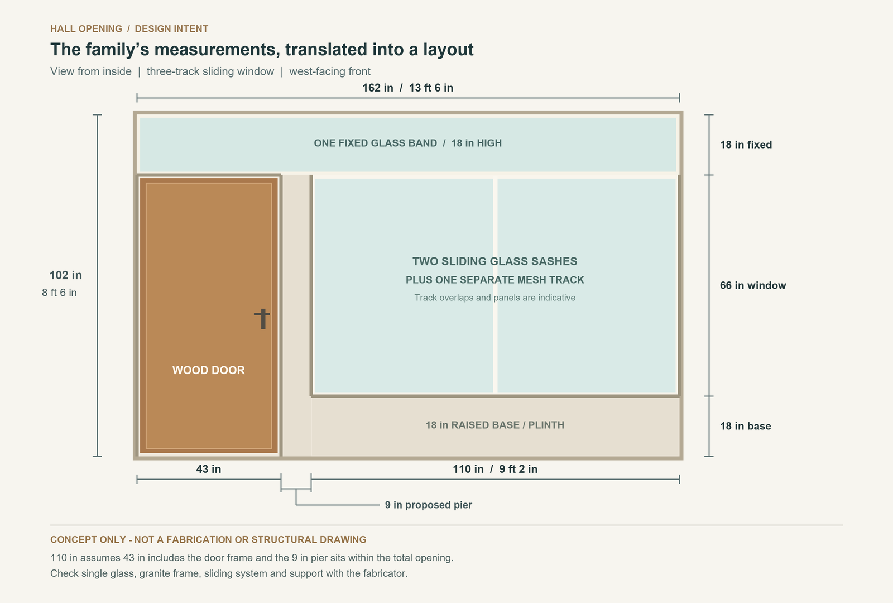

# Ansal A60, Ajmer: renovation research and hall opening concept

**Prepared:** 8 November 2026  
**Design direction:** warm modern with restrained contemporary Indian details  
**Working allowance:** approximately ₹3 lakh for this hall opening including installation; the rest of the villa is a separate project.  
**Status:** family discussion and quotations. This is not a measured survey, working drawing, structural design, or contractor quotation.

The inside image is an AI-generated concept based on the supplied **Hall Right.jpg**. It shows the fixed upper band, a wood door on the left, a proposed pier, and a raised base only under the window. It is useful for discussing colour and character, but it does not prove precise dimensions, track operation or constructability.

The exterior close-up is based on the actual **IMG20260926121303.jpg**. From outside, the door is on the right.

The wide exterior concept is based on **Iphone Wide Front Close.jpeg**. Refreshed facade paint and garden are visual context; those whole-house works are not included in the opening budget. The renders may depict the mesh alongside the glass as if it were a third side-by-side panel. The actual brief is two glass sashes that slide past one another on their own rails, plus a mesh sash on a third rail; obtain a manufacturer's plan and operation drawing.

## 1. What the family has confirmed

- The large hall opening in **Hall Right.jpg** is the intended location. It looks out toward the front garden.
- Total opening: **13 ft 6 in wide × 8 ft 6 in high** (162 × 102 in).
- The **door opening, including its frame, is 43 in wide**. The door is wooden and its frame is granite.
- A **9 in pier is proposed** between the door and window; it is not currently present. It is within the overall 13 ft 6 in width.
- The window alone has a solid **18 in raised base**, measured from the finished floor. Above that, the main window is **5 ft 6 in high**, with an **18 in fixed transparent upper band** extending above the door and window. The upper glass is for light and need not open.
- The desired appearance is warm modern, with a subtle contemporary Indian feeling. The family also wants granite framing at the window.
- The hall opening faces **west**. The main window is to be a **three-track sliding system: two glass sashes and one independently sliding insect-mesh sash**. Compare suitable uPVC and aluminium profiles.
- The family has set an approximate **₹3 lakh working allowance** for this hall door-and-window opening, including installation; it is not a whole-villa renovation budget.

**Working arithmetic:** 162 - 43 - 9 = **110 in, or 9 ft 2 in**, for the window section. Vertically, 18 + 66 + 18 = **102 in, or 8 ft 6 in**. The door opening below the top band is about 84 in, or 7 ft, high. These are opening-level dimensions. The actual glass and usable door passage will be smaller after granite, profiles, installation clearances and seals are measured. Ask the surveyor to verify whether the given dimensions are rough masonry or finished face dimensions.

The **upper band is drawn as one uninterrupted fixed pane** to respect the family's wording. The concept assumes that the proposed pier stops below the band. Both the pier and the full-width pane require a fabricator and, where structural support is affected, a structural engineer to check the actual site. The drawing does not authorize cutting an existing beam, column or lintel.

## 2. Recommended design

**Overall look.** Keep the hall bright with warm off-white paint, warm-white window profiles, a simple warm wood door, and restrained light-beige or grey granite. The existing large light-coloured hall tiles appear potentially reusable if a close inspection finds them sound. A thin granite edge and a matching sill provide Indian character without heavy ornament. Take actual samples into the hall and view them in morning and afternoon light.

**Window.** Price the family's three-track layout: two glass sashes on separate tracks plus an independently sliding mesh sash on a third track. Suppliers may use track terminology differently, so state the required moving parts explicitly. Ask for a plan/section and a demonstration showing how the mesh protects the open side, how much of the window can be opened, and the rollers, interlocks, locks and drainage. Two glass sashes sliding past one another will normally leave roughly half the window width available, less profiles and overlaps; confirm the actual clear opening. A real [Indian product example](https://shop.simmplyperfect.com/product/99-series-3-track-2-glass-panels-sliding-with-1-mesh-panel) describes this configuration.

Compare warm-white uPVC and an aluminium system with the same glazing, mesh, hardware and installation. uPVC generally transmits less heat through the frame than ordinary non-thermally-broken aluminium; ask whether the aluminium option has a thermal break and request whole-window performance where available. Select profiles and roller capacity for the approximately 110 in wide opening and the actual sash size and weight. Choose the final frame colour with physical samples.

**uPVC option.** Ask for the profile brand and series, UV/weather suitability, reinforcement details specified by that system for these sash sizes, roller capacity, gasket and lock details, and written warranty. White uPVC is a sensible first quote for the illustrated warm, light finish. India's IS 17953:2023 addresses the uPVC profiles; it does not by itself certify the finished installation.

**Aluminium option.** Ask for the named system and section sizes, finish, roller and locking hardware, and whether a thermal break is included. Aluminium can offer slimmer-looking sections, but its final appearance, span and performance depend on the system rather than on the metal alone. Compare the complete installed quote against the uPVC option, with identical glazing, mesh and warranty scope.

**Door and granite.** Use an exterior-suitable wooden door or quality exterior-grade solid-core wooden flush shutter, finished for the actual rain and sun exposure. Specify the granite door frame and window reveals/sill by stone type, thickness, width, edge finish, number of visible faces, and running length. Ask the carpenter and stonemason for a detail showing how the granite jamb, timber door, hinges, lock and wall are securely anchored and coordinated. Avoid assuming that decorative stone alone is the door's support. Keep the 43 in measurement inclusive of the granite frame, as confirmed by the family. The proposed window's granite framing must not cover the high glass.

**Upper fixed glass.** The full width of the opening is 13 ft 6 in, approximately **4.11 m**, while the actual glass will be smaller once frame dimensions are deducted. Ask suppliers to quote (A) the requested single fixed pane and (B) an optional alternative with the fewest slim divisions, as a separate comparison only. For option A, obtain the supplier's written maximum pane size, glass specification, load and deflection checks, handling/access method, support/fixing detail, and price. A full-width single pane may require special sourcing or raise the price; availability at this exact size has not been verified. If a division proves necessary for safety, sourcing, or the budget, agree it with the family before changing the design.

**Glass.** Request pane-specific safety glass selection and thickness from the fabricator, especially near the door and for the large high-level pane. Ask about laminated glass when retention of broken glass is important; toughened and laminated glass are different products. Safety and wind-load checks decide the specification, not an assumed thickness. Ask for a clear or lightly solar-control glass option with stated visible light transmission (VLT) and solar heat gain coefficient (SHGC). A lower SHGC reduces solar heat admitted; low-E alone does not guarantee an appropriate solar-control specification. Compare the additional price against a shaded clear-glass option.

**Ventilation.** Because the upper band is fixed, it provides daylight but no airflow. Ensure a useful part of the main window opens and is screened; do not rely on the high band for ventilation. The hall has openings on more than one side in the photos, so retain usable openings to take advantage of cross ventilation when the outside air is comfortable. The [Bureau of Energy Efficiency's Eco-Niwas Samhita 2024](https://www.beeindia.gov.in/WriteReadData/RTF1984/1772175926.pdf) explains natural ventilation and shading principles. It is used here for design guidance; whether the code legally applies to this particular renovation depends on its scope, state adoption, and authority requirements.

## 3. Why the Ajmer setting matters

The India Meteorological Department's Ajmer 1991-2020 table reports a **40.3°C mean daily maximum in May**, and average rain of **182.2 mm in July** and **180.6 mm in August**. The window therefore has to handle both strong summer heat and monsoon rain, rather than being selected only for appearance. [IMD Ajmer climate table](https://mausam.imd.gov.in/jaipur/mcdata/extreme_ajmer.pdf).

- **Sun and heat:** the family confirms that the opening faces **west**, so examine late-afternoon solar exposure and glare carefully. Compare a suitable exterior screen, vertical fins, planting or an appropriately designed awning; a horizontal overhang alone can be less effective against low-angle sun. The existing balcony may provide some shelter but its actual shadow must be checked. Ask for low-solar-gain glass with useful daylight transmission, and compare quoted SHGC and VLT figures rather than accepting an undefined dark tint or generic low-E label. [US Department of Energy: west-facing light and heat](https://bsesc.energy.gov/energy-basics/natural-light-and-daylighting); [glass performance](https://www.energy.gov/cmei/femp/purchasing-energy-efficient-residential-windows-doors-and-skylights).
- **Rain:** include a water-managed, outward-sloping external sill, suitable end details and a drip; seal joints with compatible exterior-grade products and leave frame drainage openings clear. The supplier must explain how the new 18 in base joins the existing opening and how water is prevented from entering at the sill, jambs and door threshold.
- **Dust and insects:** choose seals, accessible fly screens and window hardware that can be cleaned. Keep openable sashes usable; fixed glass throughout would reduce ventilation.
- **Three open sides:** retain and improve airflow between the front, left and rear when the outside air is cooler, while considering security and privacy. The direction and room-to-room route still need to be verified.

## 4. Working budget for this one hall opening

The family now wants to plan at approximately **₹3,00,000 for this hall opening including installation**, without treating the budget as a rigid design constraint at this stage. The amounts below are **illustrative planning allowances, not supplier quotations**. They cover the door, window, upper pane, granite and directly related installation. They do not pay for renovating the whole front elevation or garden shown in the AI image.

Area basis: 162 in total opening width, with the 43 in door opening and 9 in pier inside it; about **50.4 sq ft** of main window plus **20.25 sq ft** of gross upper band, or **70.7 sq ft combined** before deducting frame and stone. Actual billable area and the final size of the requested single pane need measurement. The single-pane amount below is an *extra allowance* beyond ordinary glazing, not a verified quote.

| Scope | Illustrative allowance, before tax |
|---|---:|
| uPVC three-track window, two glass sashes, mesh, standard fixed glazing, hardware and installation | ₹70,000 |
| Extra allowance for the requested long single upper pane and special handling | ₹25,000 |
| Exterior-suitable wooden door shutter, finish and hardware, installed | ₹30,000 |
| Granite door frame and window framing/sill, supply and fixing | ₹22,000 |
| New 18 in window base and proposed 9 in pier, waterproofing and plaster | ₹24,000 |
| Dismantling, debris disposal, sealing and local touch-ups | ₹12,000 |
| Survey and local structural/fabricator coordination | ₹8,000 |
| **Illustrative pre-tax subtotal** | **₹1,91,000** |
| Illustrative tax allowance, calculated at 18% for budgeting only | ₹34,380 |
| Contingency for unforeseen minor items | ₹24,620 |
| **Illustrative working total** | **₹2,50,000** |
| **Difference below ₹3 lakh working allowance** | **₹50,000** |

These numbers are a cost-planning exercise, not a price promise. A [local Ajmer listing](https://www.aajjo.com/product/upvc-window-13) advertises a white uPVC window at ₹550/sq ft; it does not establish the installed price of this specification. A [three-track example from Hyderabad](https://shop.simmplyperfect.com/product/99-series-3-track-2-glass-panels-sliding-with-1-mesh-panel) describes two glass sashes and one mesh sash, but its price and service area are not an Ajmer quote. Glass choice, a long single pane, section sizes, installation, transport, finish, tax and the supplier's minimum billing area can materially change the price. Ask for the solar-control glass upgrade separately; it is not established as included in the standard-window allowance. Actual GST and charges depend on the suppliers and invoices; 18% here is only a planning assumption.

Seek separate written uPVC and aluminium quotes with identical glass and track specifications. A specialist single pane, premium solar-control or laminated glazing, necessary structural work, and special lifting can push the actual total above these placeholders. The table does **not** include a replacement lintel or major structural alteration, major damp repairs, whole-facade painting, landscaping, security grilles, solar, furniture or other windows. If major work is required, obtain a separate written estimate before changing scope. Do not silently divide the requested upper pane; discuss any necessary alternatives with the family.

## 5. Implementation and technical checks

1. **Survey first.** Measure width, height, diagonals and wall thickness at several points; confirm finished floor and outside levels. Inspect the existing lintel/beam, available fixing surfaces, door swing and opening, and routes for carrying a long glass pane into the site. Verify where the 9 in pier can stand without cutting structure or blocking the upper band.
2. **Structural and supplier coordination.** An engineer should assess the existing support and any proposed structural alteration; the fabricator sizes the window profiles, glass, anchors and joints for the actual spans and exposure. The new pier should not be assumed to carry building loads or glass until designed for that purpose.
3. **Agree the drawings before fabrication.** The drawing should show outside/inside faces, clear passage, granite dimensions and fixings, door swing, all glazing, any mullions, window operations, insect screens, sill and threshold water details, and the upper pane's support. Do not measure from the AI picture.
4. **Build and waterproof the base and pier.** Coordinate with existing masonry, finishes and damp protection. Slope the outside sill outwards, add proper end details and drain water away. Do not let granite or sealant block the window frame's drain holes.
5. **Install and finish.** Mechanically secure assemblies to suitable backing as designed; provide compatible movement joints, sealant and flashing rather than relying on sealant alone. Protect stone, floor and door, then reinstate plaster and paint after curing.
6. **Acceptance.** Check that the door locks and opens freely, the specified window sections open and screens fit, glass and profiles match the order, all drains are clear, joints are continuous, and no damage or sharp edges remain. Agree a controlled external water test and remedy before final sign-off. Obtain invoice, profile/glass identification, warranties and service contact.

Indian references to ask a supplier about include [IS 17953:2023 for uPVC profiles](https://www.bis.gov.in/product-certification/product-specific-guidelines/?lang=en), [IS 1948:2024 for aluminium-framed doors, windows and sliders](https://services.bis.gov.in/tmp/Circular_slA8_2025-02-24.pdf), and [IS 2553 Part 1:2018 for architectural safety glass](https://www.services.bis.gov.in/tmp/tbl5_2024-11-08_1177.pdf). A compliant profile by itself does not certify the entire installed assembly; request documents applicable to the actual products.

**Permissions:** altering the front facade, adding a new pier or changing openings can have different requirements from ordinary interior repairs. The [Ajmer Development Authority Act](https://lsg.urban.rajasthan.gov.in/content/dam/raj/udh/development-authority/ada-ajmer/pdf/ActsandLaws/Ajmer_Devel_pment_Authority_act_2013.pdf) discusses permission and exceptions, and Rajasthan publishes [building bye-laws](https://www.lsg.urban.rajasthan.gov.in/content/raj/udh/udh-department/en/building-bye-laws0.html). Ask a local architect and the development/society management which approvals, if any, apply to this specific house and scope before work; do not assume exemption from a photograph.

## 6. Ajmer quotation leads

These are research leads, not endorsements or verified quotations. Confirm current contact details, site coverage, service and availability yourself. Give each the same drawing and request separate quotes for the single-pane band and, if needed, an alternative.

- [Bharat Trading Agency / Fenesta partner](https://www.fenesta.com/locate-us/partner-showroom-bharat-trading-agency-ajmer-rajasthan), 138 Anjali Tower, opposite Gyan Vihar Gate, B.K. Kaul Nagar, Ajmer. Manufacturer's site lists the Ajmer partner and a central number, 1800 102 9880.
- [M/S Global Fennester](https://www.aajjo.com/product/upvc-window-13), 126 RIICO Industrial Area, 1/A Makhupura, Ajmer. Directory listing advertises a white uPVC window; verify installation, source of the glass and single-pane capability.
- [Praveen Rolling Shutter and Steel Industries](https://praveenrollingshutters.co.in/upvc-window), Naya Bazar Road, Ajmer; the supplier lists uPVC windows and local contact details. Confirm their specific system, after-sales coverage and stone/door coordination.

Request at least three itemised written offers with **the same** dimensions, fixed high pane, window operations, glass type, insect mesh, granite and door scope. Ask for installation, transport, removal, wastage, taxes, warranty, payment milestones, delivery date and exclusions separately. Avoid paying for fabrication until the final site measurement and drawing are approved by the family.

## 7. Whole-villa priorities beyond the hall opening

The folder contains front, side, rear, hall, bedroom, kitchen and bathroom images. These support a **preliminary sequence**, not a room-by-room design or a whole-house quotation.

1. **Investigate water and safety first.** Several outside elevations show substantial paint peeling, and bathroom photo **IMG20261103114854.jpg** shows damaged/discoloured plaster and cracks near the ceiling. Another photo, **IMG20260714110653.jpg**, shows damaged or lifted wood-look flooring near a threshold. These are visual observations, not a diagnosis of the cause. Check the terrace, parapet, balcony, wet-area plumbing, external walls, window junctions and site drainage; identify and repair water entry before replastering, painting or replacing flooring. Have a qualified electrician inspect wiring, earthing and wet-area power.
2. **Close the building envelope.** Survey and replace or repair damaged windows/doors in priority order, protect the front, left and rear exposures, and resolve sill and courtyard drainage. Preserve the useful existing light and cross ventilation.
3. **Services and wet areas.** Pressure-test water lines and check waste and waterproofing. Decide which kitchen and bathroom fittings can be repaired or retained; avoid demolishing sound work without a tested reason.
4. **Interiors.** Reuse sound hall flooring where practical, then coordinate paint, lighting, fans, furniture and storage around a warm neutral palette. Address damaged upstairs flooring only after the cause is known.
5. **Exterior and garden.** After repairs cure, prepare and repaint the exterior; design planting, shade and low-maintenance paths without directing water toward walls or blocking ventilation. Inspect balcony railings and external stair for condition and safety.
6. **Later energy decisions.** If rooftop solar interests the family, first repair and assess the roof, review electricity bills and check current eligibility with [Ajmer Vidyut Vitran Nigam](https://energy.rajasthan.gov.in/AVVNL/) and the [national rooftop solar portal](https://solarrooftop.pmsuryaghar.gov.in/). Treat solar as a separate budget and verify current scheme terms before committing.

## 8. Inputs still useful for the next design round

- A simple floor plan with room names and measured dimensions, or a hand sketch; location of kitchen, bedrooms, bathrooms, stairs and which side is attached.
- How much direct afternoon sun reaches the west-facing opening, and which other openings should retain natural ventilation, privacy and security.
- A closer front-on photo with the whole hall opening and a tape or laser measure visible. Confirm whether 13 ft 6 in and 8 ft 6 in are rough masonry opening dimensions or finished measurements.
- Preference for white uPVC versus aluminium profile and colour; whether security grilles, accessibility features or protection for children/pets are needed. Confirm that the chosen mesh can cover the open portion from either side.
- Whether the family will accept a slim division **only if** a single fixed glass pane is impractical or unaffordable, and what maximum extra cost is acceptable.
- Age of the house, known leakage history, any existing plans or approvals, occupancy schedule, overall renovation priorities and a separate whole-villa budget.

**Research checked:** 8 November 2026. Supplier listings and prices can change; ask for current written offers and on-site verification.
